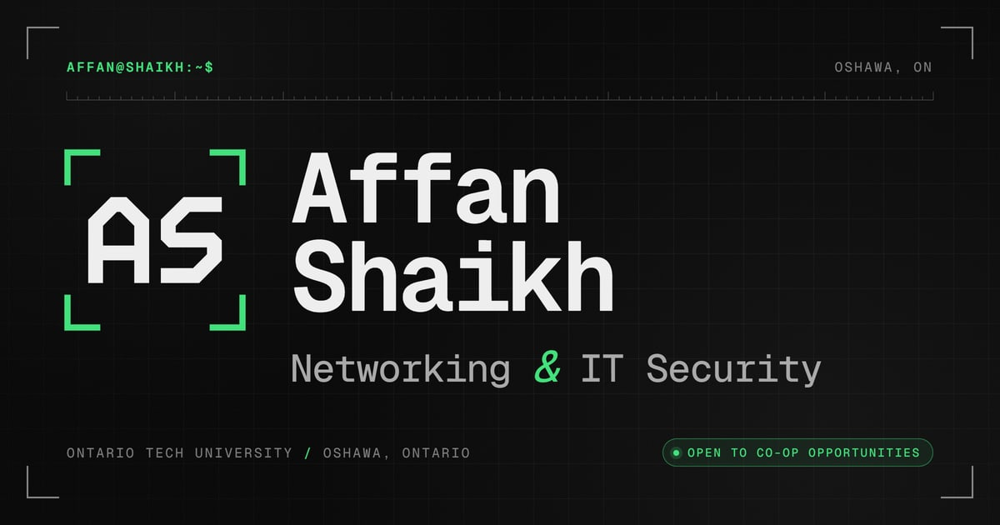

<div align="center">
  <h1>Affan Shaikh Portfolio</h1>
  <p><strong>Networking, cybersecurity, infrastructure, and software work presented as evidence-backed case studies.</strong></p>
  <p>A responsive React portfolio for Affan Shaikh, a Networking and IT Security student at Ontario Tech University.</p>

  <p>
    <a href="https://affan-shaikh.pages.dev"></a>
    <a href="https://affan-interactive-lab.pages.dev"></a>
    
  </p>

  <p>
    <a href="https://affan-shaikh.pages.dev/log">Case studies</a> ·
    <a href="https://affan-shaikh.pages.dev/stack">Technical stack</a> ·
    <a href="https://affan-shaikh.pages.dev/contact">Contact</a>
  </p>
</div>



## What the site does

- **Leads with evidence.** Project pages separate implemented work, measured results, security boundaries, and planned improvements.
- **Connects skills to proof.** The stack page links technologies to the projects and labs where they were used.
- **Keeps long-form work readable.** Case files give technical projects enough context without crowding the main page.
- **Preserves old links.** Earlier `/work/*` URLs redirect to their matching `/log/*` case files.
- **Adapts to the device.** Reduced-motion and lower-power paths avoid mounting the heavier effects.
- **Keeps contact simple.** Recruiters can reach the portfolio, resume, GitHub, LinkedIn, and Interactive Lab without searching.

## Main routes

| Route | Purpose |
| --- | --- |
| `/` | Overview, selected evidence, experience, and project entry points |
| `/about` | Background and working approach |
| `/stack` | Skills connected to real projects |
| `/log` | Case files, experience, education, and community work |
| `/log/:slug` | Long-form project case study |
| `/contact` | Email, profiles, resume, and Interactive Lab |

## Visual system

The interface uses near-black surfaces, white Geist Mono typography, restrained grey structure, and phosphor green as its main accent. Rust appears only as a secondary highlight.

- Motion communicates loading, state changes, and navigation rather than decorating every surface.
- Each page mounts at most one continuous canvas or WebGL effect.
- Semantic routes and conventional links remain available beneath the visual layer.
- Project artwork and social-preview graphics are generated for the site; no stock imagery is used.

React Bits components are adapted for specific jobs, including the evidence counter, identity lanyard, Magic Bento layout, Spotlight Cards, project backgrounds, Spring Check feedback, Folder artifact browser, and Electric Border contact treatment. The complete registry lives in [`src/data/reactbits.ts`](src/data/reactbits.ts).

## How it works

```text
Typed project and experience data
              ↓
React routes + reusable evidence components
              ↓
Scoped motion, canvas, and WebGL enhancements
              ↓
Static Vite production build
              ↓
Cloudflare Pages + direct-route fallback
```

## Local development

```bash
git clone https://github.com/sil6428/affan-portfolio.git
cd affan-portfolio
npm install
npm run dev
```

The development server uses `http://localhost:5199`.

Build and preview the production output:

```bash
npm run build
npm run preview
```

## Verification

```bash
npm run lint
npm run build
node scripts/audit.mjs --routes "/,/about,/stack,/log,/log/otnow,/contact"
```

The browser audit checks page structure, accessibility, overflow, canvas use, and broken links across representative routes. The production site also includes reduced-motion and lower-power fallbacks for heavier visual effects.

## Deployment

Cloudflare Pages serves the static `dist/` output. `VITE_SITE_URL` supplies the canonical production address used by social-preview metadata:

```powershell
$env:VITE_SITE_URL='https://affan-shaikh.pages.dev'
npm run deploy:pages
Remove-Item Env:VITE_SITE_URL
```

`public/_redirects` sends direct route requests to `index.html`, so a case-study link works when opened directly.

## Development

### Technology

- React 19, TypeScript, Vite, and React Router
- Tailwind CSS
- GSAP and Motion
- Three.js, React Three Fiber, OGL, and Matter.js
- Cloudflare Pages
- Oxc, Playwright, Axe, and Sharp for validation and assets

### Repository map

| Path | Purpose |
| --- | --- |
| `src/app/` | Application shell, routing, and page composition |
| `src/pages/` | Route-level portfolio views |
| `src/components/` | Reusable interface, evidence, and interaction components |
| `src/data/` | Projects, experience, skills, links, and React Bits registry |
| `src/lib/` | Shared helpers and platform-aware behavior |
| `public/art/` | Social preview, project artwork, badges, and logos |
| `scripts/audit.mjs` | Rendered-route, accessibility, overflow, and link audit |
| `scripts/generate-art.mjs` | Deterministic project-art generation |

## Related project

The original Three.js room now lives independently as the [Affan Interactive Lab](https://affan-interactive-lab.pages.dev), with source at [sil6428/affan-interactive-lab](https://github.com/sil6428/affan-interactive-lab). It is the deeper interactive showcase; this repository is the faster professional entry point.

## Status and licence

The portfolio is actively maintained and deployed from `main`. Project results are presented with their original scope and limitations rather than as production security claims.

Copyright © 2026 Affan Shaikh. All rights reserved. The source is public for portfolio review; reuse, redistribution, modification, or publication requires prior written permission.
